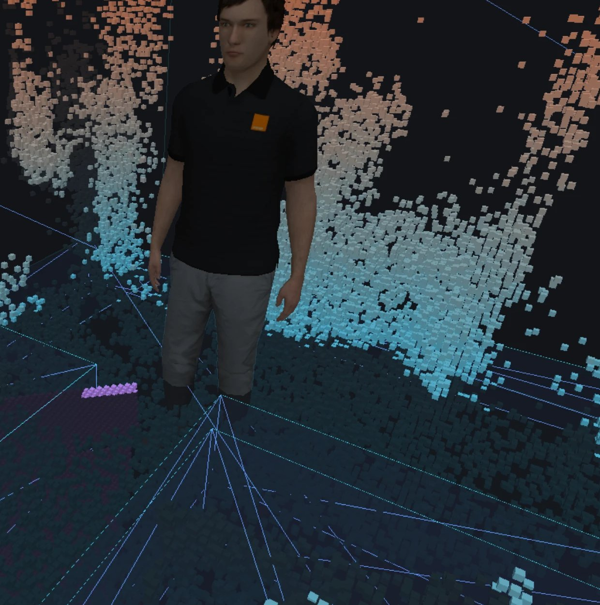
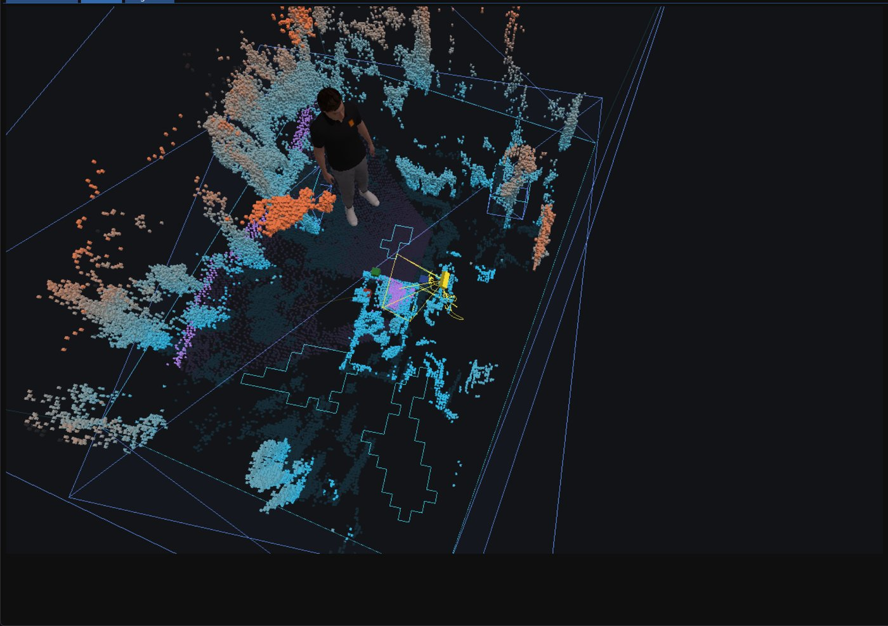
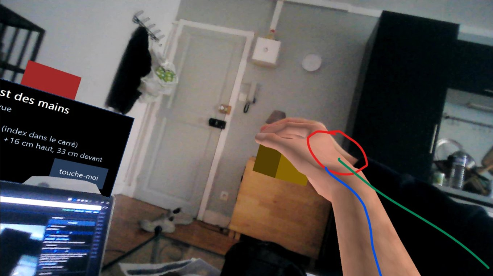
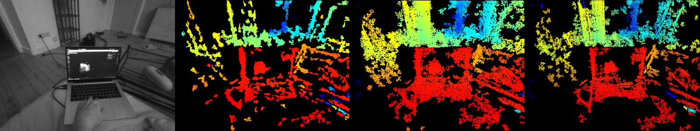

# myViture

A technician assistant for the **VITURE Luma Ultra** optical see-through AR glasses: a virtual human who walks in your room, stands on the real floor and shows you where things are, driven by voice or by another program (MCP).

<p align="center">
  
  
</p>
<p align="center">
  
  
</p>

## What it does

The native Windows app (`native/`, C++ / Direct3D 11):

- **Head tracking**: 6DoF from VITURE's engine, with our own late latching and rotation timewarp. Side-by-side 3840×1200 at 60 or 90 Hz.
- **Room map**: GPU stereo depth (census + 8-path SGM) from the two tracking cameras. Depth Anything V2 runs on the RGB camera, scaled by the stereo. Then a voxel map, a mesh for occlusion, the floor and the walkable area.
- **Virtual human**: Rocketbox character, idle and walk animations, A* paths on the floor seen. It comes to you, wanders, and walks to an object to point at it.
- **Hands**: skeleton from VITURE's hand tracking, predicted to the display. Three cubes fall on the scanned surfaces and can be grabbed and thrown.
- **Objects and voice**: name what you look at ("scan drill"), then ask "where is the drill?". Speech goes to Whisper through the lab's Orange gateway.
- **MCP server** (JSON-RPC over HTTP): room, user, human, markers, robot-frame calibration, so a robot's MCP can orchestrate it.
- **Recording**: MP4 of the RGB camera with the virtual content over it. A dashboard (Dear ImGui) shows RGB, 3D and diagnostics views.

The first version, a WebUSB web app with its own USB driver, is in `src/`. It is documented in [docs/web-app.md](docs/web-app.md), with the decoded USB protocol.

## Status

Work on the PC version stopped in October 2026. The next step is a standalone version on the VITURE neckband (Unity SDK).

## Build and run

Windows 11, Visual Studio 2026 (C++), and VITURE SpaceWalker installed (the app loads its `carina_vio.dll`, not included here). Glasses connected, display set to Extend (Win+P).

```bat
native\fetch_deps.bat
native\build.bat
native\myviture.exe
```

`fetch_deps.bat` downloads ONNX Runtime, DirectML, the hand and Depth Anything models, and bakes the human. Voice commands need `.env.local` at the repository root with `ORANGE_GATEWAY` and `ORANGE_PROXY_SECRET`. It is never committed.

## Credits

Microsoft Rocketbox avatars (MIT), Depth Anything V2 Small (Apache 2.0), ONNX Runtime and DirectML (MIT), Dear ImGui (MIT), MediaPipe hand models via opencv_zoo (Apache 2.0). VITURE's runtime is proprietary and not part of this repository.

## License

[MIT](LICENSE), for the code of this repository (third-party parts keep their own licenses).

